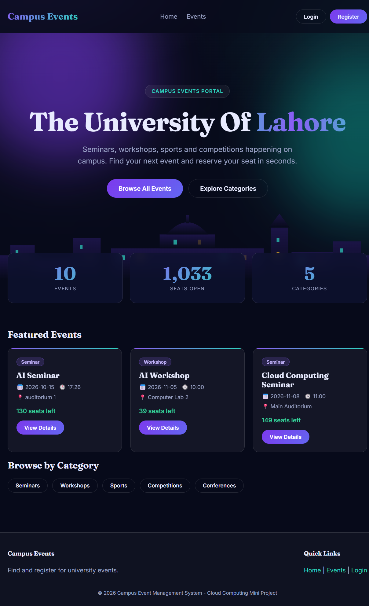
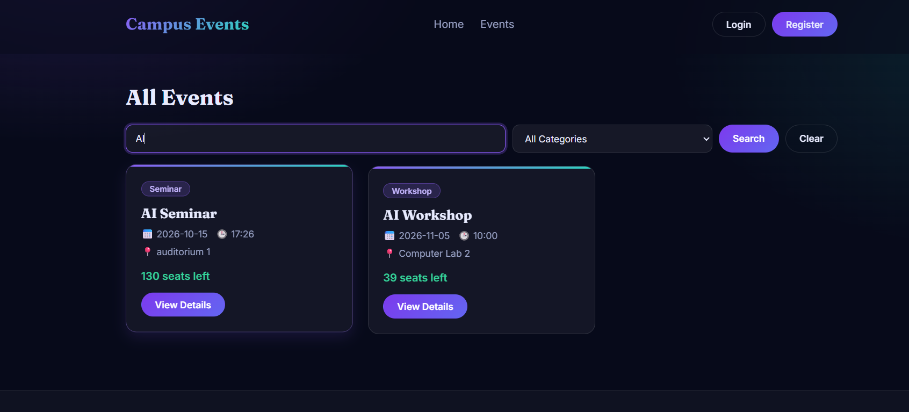
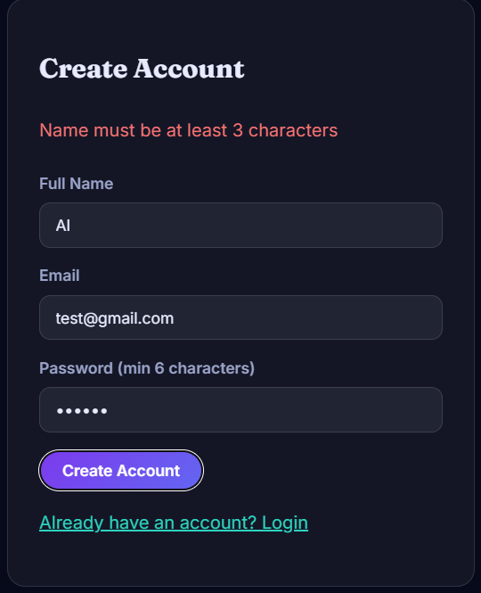
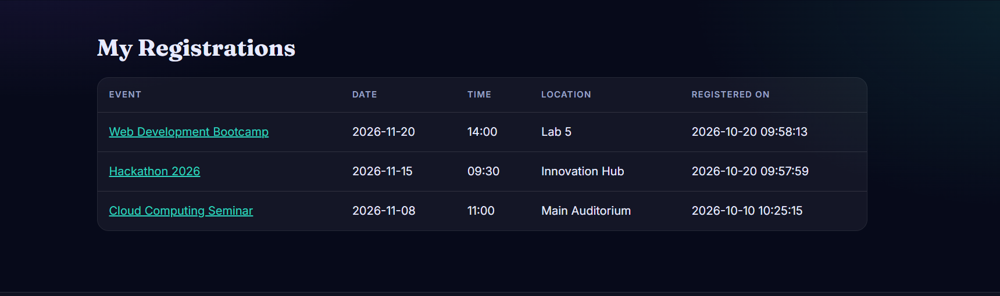
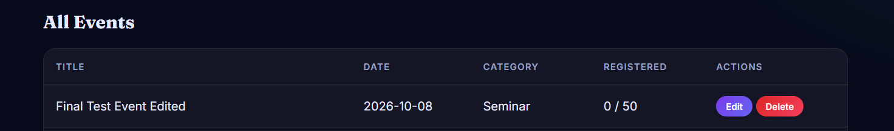
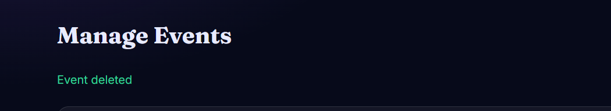

# Campus Event Management System

A full-stack web application where university students can browse and register for campus events, and an admin can create, update and delete events. Built as a Cloud Computing mini project at The University of Lahore.

## Features

**Students**
- Browse all events as animated cards
- Search events by keyword and filter by category
- Sign up with form validation (name, email and password checks)
- Log in securely and register for events (duplicate and capacity checks)
- "My Registrations" dashboard listing the events they registered for

**Admin**
- Create, edit and delete events from a management page
- Capacity cannot be set below the number of students already registered

**General**
- JWT authentication with student and admin roles
- Passwords stored as bcrypt hashes
- Responsive dark "aurora" design with an animated hero, scroll animations and live stat counters

## Team Members

| Name | SAP ID | Role |
|------|--------|------|
| Umar Faheem | 70176534 | Team Lead, Database, Integration, Code Review |
| Muhammad Amir Ijaz | 70176907 | Front-end Functionality and Registrations API |
| Omer Javed | 70176744 | Back-end APIs, Documentation, API Testing |
| Rana Haroon | 70137442 | Front-end UI Design |
| Anas Subhani | 70176507 | System Testing and Quality Assurance |

## Technologies

| Layer | Technology |
|-------|------------|
| Front end | HTML, CSS, JavaScript (no framework) |
| Back end | Node.js, Express.js |
| Database | SQLite (Node's built-in `node:sqlite`) |
| Security | JWT (2 hour expiry), bcryptjs, role-based access |
| Tools | Git, GitHub (Issues, Branches, Pull Requests), Postman, VS Code |

## Project Structure

```
campus-event-management/
  frontend/
    index.html          Home page
    pages/              events, event-details, login, admin, dashboard
    components/         navbar, footer, event card
    src/css/style.css   Theme and animations
    src/js/             api helper, page scripts, effects
  backend/
    server.js           Express server (also serves the frontend)
    routes/             API routes
    controllers/        Request handlers
    middleware/auth.js  verifyToken and requireAdmin
    database/           db.js (tables) and seed.js (sample data)
  documentation/        API testing report
  screenshots/          Screenshots of the working system
```

## Installation and Running

**Requirements:** Node.js v24 or newer, and Git.

1. Clone the repository:

   ```
   git clone https://github.com/umerfaheemgit-hub/campus-event-management.git
   cd campus-event-management/backend
   ```

2. Install the packages:

   ```
   npm install
   ```

3. Create the database with sample data (2 users and sample events):

   ```
   npm run seed
   ```

4. Start the server:

   ```
   npm start
   ```

5. Open **http://localhost:5000** in your browser. The Express server serves the front end, so there is nothing else to start.

**Demo accounts**

| Role | Email | Password |
|------|-------|----------|
| Admin | admin@campus.edu | admin123 |
| Student | student@campus.edu | student123 |

## API Endpoints

| Method | URL | Access | Description |
|--------|-----|--------|-------------|
| GET | /api/events | Public | List events (`?search=` and `?category=`) |
| GET | /api/events/:id | Public | Get one event |
| POST | /api/events | Admin | Create an event |
| PUT | /api/events/:id | Admin | Update an event |
| DELETE | /api/events/:id | Admin | Delete an event |
| POST | /api/signup | Public | Create a student account |
| POST | /api/login | Public | Log in and receive a JWT token |
| POST | /api/register | Logged in | Register for an event |
| GET | /api/registrations | Logged in | Admin sees all, a student sees their own |

Protected routes need the header `Authorization: Bearer <token>`.

The API was tested with Postman. See [documentation/api-testing.md](documentation/api-testing.md).

## Screenshots

### Home page


### Responsive layout on a phone


### Search and category filter


### Signup validation


### Student dashboard (My Registrations)


### Admin: edit and delete events



## Git Workflow

The team worked with a feature-branch workflow on GitHub:

- Work was planned as **5 GitHub Issues**, each labelled and assigned to a team member.
- Every member worked on **their own branch** (`feature/backend-api`, `feature/frontend-functionality`, `feature/frontend-ui`) with small, meaningful commits under their own name and email.
- Each branch was merged only through a **Pull Request** that referenced its Issue (`Closes #N`).
- The Team Lead **reviewed every Pull Request** with inline comments, approved it and merged it into `main`.
- At the end: **5 of 5 Issues closed** and **all Pull Requests merged**.

| Member | Issue | Branch | Pull Request |
|--------|-------|--------|--------------|
| Omer Javed | #3 Develop Event REST API | `feature/backend-api` | #11 |
| Muhammad Amir Ijaz | #2 Create Event Registration Form | `feature/frontend-functionality` | #12 |
| Rana Haroon | #1 Create Home Page | `feature/frontend-ui` | #13 |
| Umar Faheem | #4 Create Database, #5 Integrate Front End and Back End | `feature/database-testing`, `feature/ui-redesign` and others | #6 to #10, #14 |

## License

Released under the MIT License. See [LICENSE](LICENSE).
