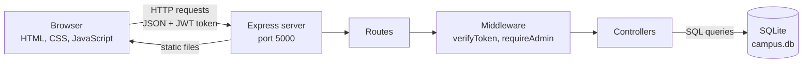
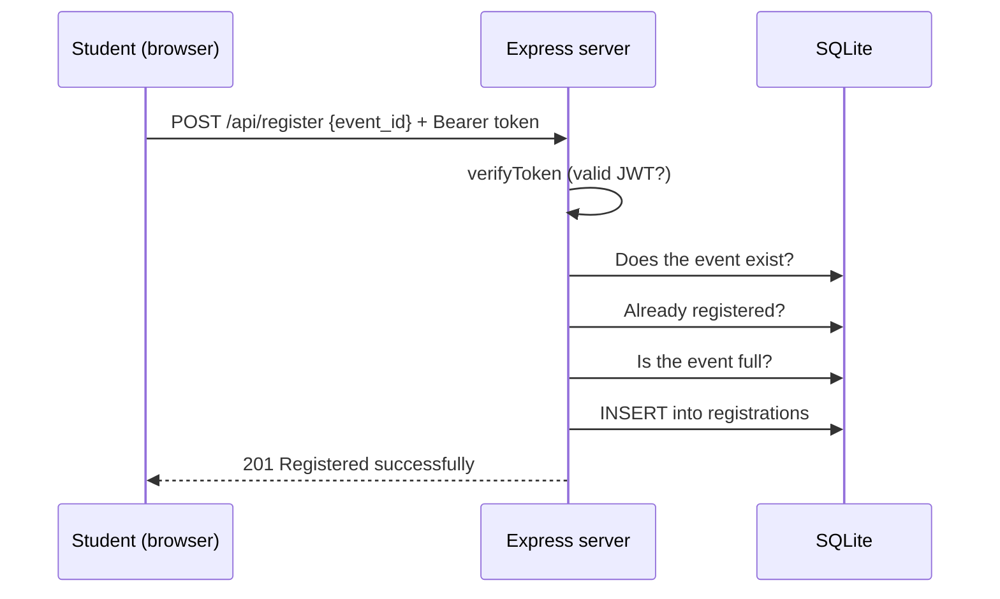

# System Architecture

## Overview

The Campus Event Management System is a three-layer web application:

1. **Front end**: static HTML, CSS and JavaScript pages that run in the browser.
2. **Back end**: a Node.js and Express REST API.
3. **Database**: a SQLite file (`backend/database/campus.db`) accessed through Node's built-in `node:sqlite` module.

The Express server also serves the front-end files, so the whole system runs from one command and one address (`http://localhost:5000`).

## Architecture diagram

## Front end

| Part | Files | Purpose |
|------|-------|---------|
| Pages | `index.html`, `pages/events.html`, `event-details.html`, `login.html`, `admin.html`, `dashboard.html` | One page per screen |
| Components | `components/navbar.js`, `footer.js`, `eventCard.js` | Shared pieces built with JavaScript and reused on every page |
| Scripts | `src/js/api.js` and one script per page | Call the API with `fetch` and update the page |
| Styling | `src/css/style.css` | Dark aurora theme, responsive layout, animations |
| Effects | `src/js/effects.js` | Scroll animations, sticky navbar effect, live stat counters |

`api.js` holds the shared helper `apiRequest`. It adds the stored JWT token to each request, so every page talks to the API the same way. The token and the logged-in user are kept in the browser's `localStorage`.

## Back end

| Folder | Responsibility |
|--------|----------------|
| `server.js` | Creates the Express app, enables CORS and JSON parsing, mounts the routes, serves the front end, handles unknown API URLs (404) and unexpected errors (500) |
| `routes/` | Maps each URL and HTTP method to a controller function |
| `middleware/auth.js` | `verifyToken` checks the JWT, `requireAdmin` allows only admins |
| `controllers/` | The logic for each request: `authController`, `eventsController`, `registrationsController` |
| `database/` | `db.js` creates the tables, `seed.js` inserts sample data |

## Authentication and roles

1. A user logs in with email and password (`POST /api/login`).
2. The server compares the password with the stored **bcrypt hash**.
3. If correct, it returns a **JWT** that contains the user's id, name and role, and expires after 2 hours.
4. The browser sends the token on later requests in the header `Authorization: Bearer <token>`.
5. `verifyToken` validates the token. Routes that change events also pass through `requireAdmin`.

Two roles exist:

| Role | Can do |
|------|--------|
| `student` | View events, register for events, see their own registrations |
| `admin` | Everything a student can, plus create, update and delete events, and see all registrations |

New sign-ups are always created as `student`.

## Request flow example: registering for an event

If any check fails, the server stops and returns an error (404 event not found, 409 already registered, 400 event full).

## Security measures

- Passwords are stored only as bcrypt hashes, never as plain text.
- Every SQL query uses **prepared statements** with `?` placeholders, which prevents SQL injection.
- The front end escapes text before inserting it into the page (`escapeHtml`), which prevents script injection.
- Admin-only routes are protected on the **server**, not just hidden in the interface.
- The JWT secret is read from the environment variable `JWT_SECRET`. A default value is used for the demo, and a real deployment must set its own secret.

## Technology choices

| Choice | Reason |
|--------|--------|
| Plain HTML, CSS, JavaScript | No build step, easy to run and to understand |
| Express | Small and standard framework for REST APIs |
| SQLite | A single file, no database server to install |
| JWT | Stateless login, so the server does not need to store sessions |
| bcryptjs | Secure password hashing that works on every platform |
