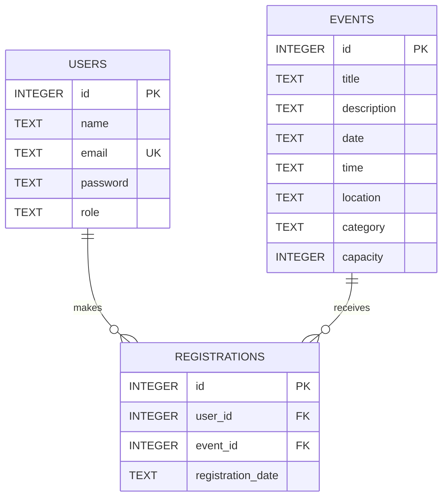

# Database Schema

The system uses **SQLite**. The database file is `backend/database/campus.db`. It is created automatically when the server starts, and it is excluded from Git (`*.db` is in `.gitignore`), so every person creates their own copy with `npm run seed`.

## Entity relationship diagram



One user can register for many events, and one event can have many registrations. The `registrations` table connects the two (a many-to-many relationship).

## Table: users

| Column | Type | Constraints | Description |
|--------|------|-------------|-------------|
| id | INTEGER | Primary key, auto-increment | Unique user id |
| name | TEXT | Not null | Full name |
| email | TEXT | Not null, unique | Login email, no two accounts can share it |
| password | TEXT | Not null | bcrypt hash of the password |
| role | TEXT | Not null, default `student` | `student` or `admin` |

## Table: events

| Column | Type | Constraints | Description |
|--------|------|-------------|-------------|
| id | INTEGER | Primary key, auto-increment | Unique event id |
| title | TEXT | Not null | Event name |
| description | TEXT | | Short description |
| date | TEXT | Not null | Date in `YYYY-MM-DD` format |
| time | TEXT | Not null | Time in `HH:MM` format |
| location | TEXT | Not null | Venue |
| category | TEXT | Not null | One of: Seminar, Workshop, Sports, Competition, Conference, Society |
| capacity | INTEGER | Not null | Maximum number of registrations |

Seats left are not stored. They are calculated when an event is read: `capacity` minus the number of rows in `registrations` for that event (returned as `registered` and `available_seats`).

## Table: registrations

| Column | Type | Constraints | Description |
|--------|------|-------------|-------------|
| id | INTEGER | Primary key, auto-increment | Unique registration id |
| user_id | INTEGER | Not null, foreign key to `users(id)` | The student who registered |
| event_id | INTEGER | Not null, foreign key to `events(id)`, `ON DELETE CASCADE` | The event |
| registration_date | TEXT | Not null, default current date and time | When the student registered |

Table-level rule: `UNIQUE (user_id, event_id)`. A student cannot register for the same event twice.

## Rules enforced

| Rule | Where it is enforced |
|------|----------------------|
| Email addresses are unique | `UNIQUE` constraint on `users.email`, plus a check in signup |
| No double registration | `UNIQUE (user_id, event_id)`, plus a check in `registerForEvent` |
| An event cannot exceed its capacity | Check in `registerForEvent` |
| Capacity cannot drop below the registered count | Check in `updateEvent` |
| Deleting an event removes its registrations | `ON DELETE CASCADE`, and an explicit delete in `deleteEvent` |
| Categories are limited to a fixed list | Check in `createEvent` and `updateEvent` |

## Sample data

Running `npm run seed` inserts data only if the events table is empty:

| Users | Email | Password | Role |
|-------|-------|----------|------|
| Admin User | admin@campus.edu | admin123 | admin |
| Test Student | student@campus.edu | student123 | student |

It also inserts **8 sample events** across the categories Workshop, Seminar, Sports, Competition and Conference.

## Example queries used by the API

List events with seats left:

```sql
SELECT e.*,
  (SELECT COUNT(*) FROM registrations r WHERE r.event_id = e.id) AS registered,
  e.capacity - (SELECT COUNT(*) FROM registrations r WHERE r.event_id = e.id) AS available_seats
FROM events e
ORDER BY e.date ASC, e.time ASC;
```

A student's registrations:

```sql
SELECT r.id, r.registration_date, e.title, e.date, e.time, e.location
FROM registrations r
JOIN events e ON e.id = r.event_id
WHERE r.user_id = ?
ORDER BY r.registration_date DESC;
```
